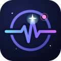

# Space Vigil



Crew health self-assessment and decision support for long-duration space missions.

Built for the 2026 NASA Space Apps Challenge, challenge
[Create Health Monitoring Software for Astronauts on Space Missions](https://www.spaceappschallenge.org/2026/challenges/health-monitoring-software/).
Team: Les Tigres de Bethesda.

**Live demo:** https://victor-andiazabal.github.io/victor-andiazabal/

## Try it

Three ways, easiest first. All crew data in the app is simulated.

### Option 1: open it in your browser (nothing to install)

Go to https://victor-andiazabal.github.io/victor-andiazabal/ on any phone, tablet or computer.

A 7-step tutorial opens on your first visit and points at the real controls. To replay it, press the **?**
button in the top bar, or use Settings, then Replay tutorial.

### Option 2: install it like an app (works offline)

Space Vigil is a progressive web app. Open the live link once while online, then install it. After that it
starts from its own icon and works without a connection.

- **iPhone or iPad (Safari):** tap the Share button, choose **Add to Home Screen**, then **Add**.
- **Android (Chrome):** open the menu (three dots), choose **Install app** (on some versions it reads
  **Add to Home screen**), then confirm.
- **Windows, macOS or Linux (Chrome or Edge):** click the install icon at the right end of the address bar, or
  open the browser menu and choose **Install Space Vigil**, then confirm.

### Option 3: run it on your computer

1. **Install Node.js (LTS)** from https://nodejs.org. The app needs Node 20.19 or newer, or 22.12 or newer
   (the requirement comes from Vite). The default installer options are fine.
2. **Download the code.** On the GitHub page, click the green **Code** button, then **Download ZIP**, and unzip
   it. Or, with git: `git clone https://github.com/victor-andiazabal/victor-andiazabal.git`.
3. **Start it** from the `vigil` folder:
   - Windows: double-click `start-windows.bat`.
   - macOS: double-click `start-mac.command`. macOS may refuse to open it the first time; right-click the
     file, choose **Open**, then **Open** again. If nothing happens, open Terminal in the folder and run
     `sh start-mac-linux.sh`.
   - Linux: in a terminal, in the folder, run `sh start-mac-linux.sh` (or `bash start-mac-linux.sh`).

   The first run installs the app's packages (internet needed, a minute or two). Then your browser opens at
   http://localhost:5173. Keep the window open while you use the app; close it to stop.

For developers, the same thing by hand:

```bash
cd vigil && npm install && npm start
```

### A 2-minute tour of the demo

The demo opens on the Commander at mission day 30 in the "sleep debt" scenario, so there is something to see.

1. **Today.** Read the status and its reason, then press the **Start check-in** button (the next action).
2. **Check-in.** Values on the first three steps (vitals, body, sleep and alertness) arrive pre-filled, marked
   "from wearable". On each step, press **Confirm all on this step**.
3. On **Symptoms**, press **None today**, then **Save check-in** on the review step. That is about six taps.
4. Back on Today, the next action becomes **Run reaction test**: a 60-second reaction test.
5. Open the **Body map** to see seven body systems coloured by the same rules, then **Alerts** to see why each
   alert fired, the source, the checklist and the message to the flight surgeon.
6. **Crew and ground link.** On Alerts, press **Send today's report**, then **Open ground console in a new window**
   (or open the same address with `?view=ground` added in a second window). The report reaches the ground
   after the link's one-way delay, and the ground can reply the same way. Demo time plays 1 minute of delay
   as 1 second.
7. **Settings** (in the More menu on a phone). Switch the environment (station, transit, rover, base), the
   scenario (nominal, solar storm, sleep debt, early infection) and the mission day. The crew tabs in the top
   bar switch between the four simulated crew members.

### Troubleshooting

- **"node is not recognized"** (or "command not found"): Node.js is not installed or the window was opened
  before the install. Install Node.js LTS from https://nodejs.org, then close the window and start again
  (restart the terminal if you use one).
- **Port 5173 is in use:** Vite takes the next free port. Read the address it prints (for example
  `http://localhost:5174/`) and open that.
- **Blank or old page after an update:** the offline cache is serving the previous version. Hard refresh
  (Ctrl+Shift+R, or Cmd+Shift+R on macOS). If that does not help, close the app and reopen it once online.
- **Want a clean demo:** Settings, then Display and data, then **Clear local data** removes manual entries,
  acknowledgements and settings.
- **`npm install` fails:** check the internet connection, delete the `node_modules` folder, and run the
  launcher again.

## The problem

On the way to Mars the one-way signal delay reaches 24 minutes, so a crew member who feels off cannot
simply call the flight surgeon. NASA's Human Research Program lists five hazards of spaceflight: radiation,
isolation and confinement, distance from Earth, altered gravity, and a hostile closed environment. Each one
shows up first as a small shift in an everyday number: a slower reaction time, a shorter night, a few extra
beats per minute at rest. Crews need a tool that notices those shifts for them and tells them what to do.

## What Space Vigil does

- **Today**: one screen with the day's status (Nominal, Watch or Act now) and its reason, the single next action,
  a compact body map, and one tile per indicator with its last 14 days as day bars. Tiles that need attention
  come first.
- **Daily check-in** in five short steps (vitals, body, sleep and alertness, symptoms, review) for blood pressure,
  heart rate, heart rate variability, breathing rate, SpO2, temperature, fasting glucose, body mass, sleep,
  sleepiness (Karolinska scale), exercise, mood, stress, symptoms and radiation dose. Keyboard, touch, or values
  pre-filled from a wearable, each with your own baseline band beside it.
- **Crew profiles**: four simulated crew members with names, roles, agencies (NASA, ESA, CSA, JAXA), generated
  portraits and days in space. Fictional people with plausible resting values; switch between them from the
  crew tabs in the top bar.
- **First-run tutorial**: seven steps that point at the real controls; replay it from the help button.
- **Built around a real wearable.** The intended live source is the Bio-Monitor (Hexoskin Astroskin) shirt that
  has flown on the ISS since 2019: ECG, HRV, breathing, SpO2, skin temperature, activity and sleep from one
  garment over Bluetooth. The Learn page shows the data path from shirt to flight surgeon.
- **Camera pulse**: 20 seconds of video from the phone or laptop camera, fingertip or face, turned into a heart-rate
  estimate on the device (photoplethysmography, Verkruysse 2008). Labelled experimental; fills the heart-rate field.
- **Reaction self-test**: a 60-second psychomotor vigilance test, the same family of test ISS crews run as the
  Reaction Self Test, with the PVT-B lapse threshold of 355 ms.
- **Personal baseline**: 14 pre-flight days give each crew member a median and a robust spread (median
  absolute deviation) per indicator. In-flight values are judged against the person, not only the population.
- **Transparent alerts**: every alert says which rule fired, with the numbers, the published source, and a
  checklist of what to do. Three levels: Nominal, Watch, Act now. Alerts that need the ground say so.
- **Flight surgeon message**: one copy-paste summary of the day's values and flags, built for a link where a
  reply takes up to 48 minutes round trip.
- **Body map**: a body figure coloured by the same rule results, grouped into seven body systems (brain and
  behavior, eyes, immune, heart and lungs, metabolism, bones and muscle, skin and radiation dose). Click a
  system to see which indicators feed it, which of the five hazards affect it, and what to do.
- **Crew and ground link with light-time delay**: the crew tablet sends the day's report to the ground console
  (open `?view=ground` in a second window) and the message arrives only after the one-way delay of the chosen
  link (Moon 3-10 s end to end with relays, Mars 4-24 min). Demo time compresses 1 minute of delay into 1 second so it plays live.
  The ground replies the same way. Messages are stored and forwarded; nothing needs a server.
- **Mission patches**: badges for habits, not readings: first check-in, 7- and 14-day streaks, a full routine
  day, reaction tests on 3 days in a week, 147 min of exercise on 5 days in a row, a complete record. Patches
  never depend on whether a value is good, so there is nothing to gain by under-reporting.
- **Trends**: every indicator over the mission with the baseline band, launch marker, scenario window and
  published cut-offs drawn on the chart. Compare the whole crew with one checkbox.
- **Routine and streak**: timed prompts for the day (reaction test after waking, vitals, exercise block,
  social time, lights-down), a check-in streak, and a progress bar.
- **Ground view**: the flight surgeon's side of the same data. Crew-by-indicator status grid, the queue of
  items the crew flagged for the ground, and per-crew notes.
- **Import**: CSV in the export layout, so cuff or wearable exports replace the simulated day.
- **Learn**: why the app exists, the five hazards, the data path from the Bio-Monitor shirt to the flight surgeon,
  how the rules decide, what each indicator means and how to measure it on board, how it was designed, and every source.
- **Four environments**: space station, deep-space transit, pressurized rover, planetary base. Each sets the
  comm delay and the expected daily radiation dose from measured values.
- **Four demo scenarios**: nominal, solar particle event, sleep debt with slowed reactions, early infection.
- Runs fully offline in the browser and installs as a web app on a tablet or phone (service worker caches
  everything after the first load). Data stays on the device; export JSON or CSV at any time.

## Where the numbers come from

Every threshold is either a published cut-off or a comparison with the crew member's own baseline, and the
alert says which. The sources are listed in [docs/SOURCES.md](docs/SOURCES.md) and inside the app under Learn.
Highlights:

| Rule | Value | Source |
| --- | --- | --- |
| Blood pressure categories | 130/80 stage 1, 140/90 stage 2, >180/120 crisis | ACC/AHA 2017 guideline |
| Fever | 38.0 °C | CDC |
| SpO2 | below 95% watch, below 90% act | Mayo Clinic |
| Fasting glucose | <70 hypoglycemia, 100-125 prediabetes range, ≥126 diabetes range | ADA Standards of Care |
| Sleepiness | Karolinska scale 7 or more flagged | Kaida et al. 2006 |
| Sleep | adults need ≥7 h; ISS crews scheduled 8.5 h, average 6.1 h | AASM; Barger et al. 2014 |
| Reaction test | 3-minute PVT-B, lapse ≥355 ms | Basner, Mollicone, Dinges 2011; NASA NTRS |
| Radiation | 600 mSv career limit, 250 mSv per solar particle event | NASA OCHMO, NASA-STD-3001 |
| Daily dose | 1.84 mSv/day in transit, 0.64 mSv/day on Mars, 0.2-0.5 mSv/day on ISS | MSL/RAD (Zeitlin 2013, Hassler 2014); Shavers 2024 |
| Exercise | about 147 min/day assigned on ISS | NASA NTRS |
| Comm delay | Moon about 1.3 s light time, 3-10 s with relays; Mars 4-24 min | NASA Ames |
| Breathing rate | 12-20 per minute typical | Cleveland Clinic |
| Heart rate variability | personal baseline only | Shaffer and Ginsberg 2017 |
| Wearable source | Bio-Monitor / Astroskin on ISS since 2019 | CSA; NASA NTRS 20190000238 |

All crew data in the demo is simulated and labelled as such. No real astronaut records are used.

## Development

To run the app, see [Try it](#try-it) above. Other scripts, from the `vigil` folder (Node 20.19+ or 22.12+):

```bash
npm run dev       # same dev server as npm start, without opening a browser
npm run lint      # oxlint
npm test          # vitest, single run
npm run build     # type-check and production build into dist/
npm run preview   # serve the production build locally
```

The tests (vitest) cover the statistics, the simulator, every alert rule at its cited cut-off, CSV import, the body map, the comm link queue, the badges, the Today grouping and the check-in draft.

The production build goes to `dist/`. The GitHub Actions workflow in
`.github/workflows/pages.yml` (at the repository root) builds and deploys to GitHub Pages on every push to `main`.

## Stack

React 19, TypeScript, Vite (with vite-plugin-pwa for the offline cache), Recharts. No backend, no accounts, no network calls after load.

## Layout

```
vigil/
  start-windows.bat, start-mac.command, start-mac-linux.sh   one-click launchers
  src/data/        indicators, crew roster, scenarios, countermeasure checklists, sources, body systems,
                   link delay presets, daily routine
  src/lib/         simulator, baseline statistics, rule engine, pulse estimation, storage, CSV, body map
                   status, comm link queue, badges
  src/components/  Today, body map, check-in, reaction test, trends, alerts, comm link, routine,
                   badges, learn, settings
  src/lib/__tests__ unit tests for the statistics, simulator, rules and screen logic
  docs/            sources, design process, demo deck (pptx), slide outline, video script, video, submission draft, pitch notes
```

## Limits

Space Vigil is a decision-support prototype, not a medical device. It does not diagnose. The published ranges are
general adult references; operational limits on a real mission are set by the flight surgeon. The 60-second
reaction test is a shortened form of the validated 3-minute PVT-B.
